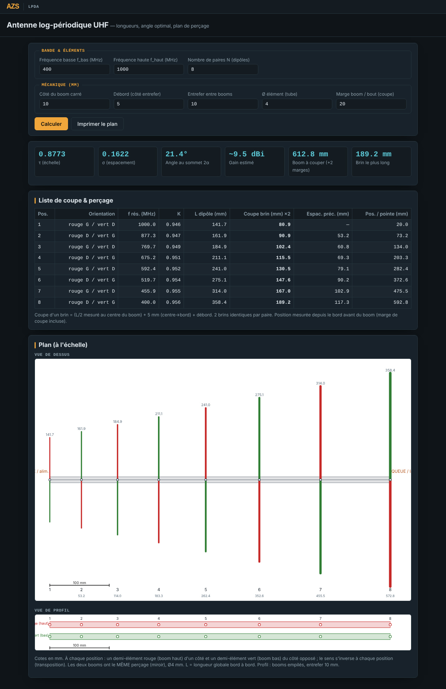

<!--
  Nom      : LISEZMOI.md
  Objet    : Présentation du calculateur d'antenne log-périodique UHF (dépôt GitHub)
  Auteur   : Eric Perret (ericperret)
  Date     : 2026-10-18
  Version  : 1.6
  Licence  : CC BY 4.0
-->

# Antenne log-périodique UHF (LPDA) — calcul et plan de perçage

🇬🇧 [English version: README.md](README.md)

▶️ **[Lancer le calculateur](https://ericperret.github.io/lpda/lpda_uhf.html)** — le calcul se fait à chaque saisie.

Calculateur autonome (un seul fichier HTML) d'antenne log-périodique à deux booms carrés, pour la bande UHF.
À partir de la bande voulue et du nombre de dipôles, il donne les longueurs de coupe, l'angle optimal, les positions de perçage et un plan à l'échelle prêt à imprimer.

Interface en français. Aucune installation, aucune librairie, aucune connexion requise.

## Utilisation

1. Ouvrir le lien ci-dessus, ou télécharger `lpda_uhf.html` et l'ouvrir dans un navigateur récent.
2. Saisir la bande (f_bas, f_haut), le nombre de paires N et la mécanique (boom, débord, entrefer, Ø des éléments, marge de coupe).
3. Les résultats se mettent à jour à chaque saisie ; **Imprimer le plan** sort le plan sans les champs de saisie.

## Fonctions

| Fonction | Description |
|---|---|
| Synthèse | τ (facteur d'échelle), σ (espacement), angle au sommet 2α, gain estimé, longueur de boom à couper, brin le plus long |
| Liste de coupe et perçage | Pour chaque position : orientation des demi-éléments, fréquence de résonance, facteur K, longueur du dipôle, longueur de coupe d'un brin (×2), espacement, position depuis le bord du boom |
| Vue de dessus | Plan à l'échelle : demi-éléments rouges (boom haut) et verts (boom bas) alternés à chaque position, cotes, réglette 100 mm |
| Vue de profil | Deux booms empilés, même perçage en miroir, entrefer |
| Impression | Mise en page dédiée : synthèse, liste et plan seulement |
| Contrôles | Entrées invalides et σ ≤ 0 (trop peu d'éléments pour la bande) signalés |

## Méthode

- Facteur d'échelle : τ = (f_bas / f_haut)^(1/(N−1)).
- Espacement de gain maximal (Carrel) : σ = 0,243·τ − 0,051.
- Demi-angle au sommet : tan α = (1 − τ) / (4σ).
- Longueur d'un dipôle : L = K · λ/2, avec K corrigé selon l'élancement L/Ø : K = 0,975 − 0,18/√(L/Ø), borné entre 0,90 et 0,98.
- Position de chaque élément depuis le sommet virtuel : x = (L/2) / tan α.
- Coupe d'un brin = L/2 (mesuré au centre du boom) + demi-côté du boom + débord.
- Gain estimé : montée saturante avec N, plafond d'environ 11 dBi (limite pratique d'une LPDA simple), légèrement plus bas pour une bande large.

## Limites

Outil de pré-dimensionnement. Le gain est une estimation ; l'adaptation à 50 Ω (lame en queue) et le diagramme ne sont pas calculés. Un réglage final à l'analyseur d'antenne reste nécessaire.

## Historique

| Version | Évolution |
|---|---|
| 1.1 | Facteur K automatique selon L/Ø ; plan en vue de dessus et vue de profil, booms rouge / vert |
| 1.5 | Gain estimé par montée saturante en N ; marge de coupe du boom ; coupe mesurée depuis le centre du boom |
| 1.6 | Charte graphique AZS (thème sombre à l'écran, bandeau AZS avec lien de retour vers www.azs.fr) ; le plan reste sur fond blanc et l'impression est inchangée |

## Licence

[CC BY 4.0](https://creativecommons.org/licenses/by/4.0/deed.fr) — Attribution.
